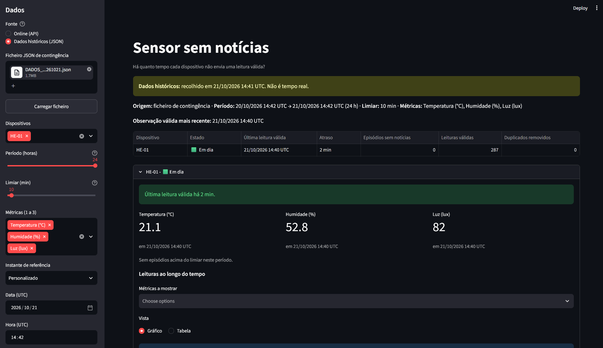
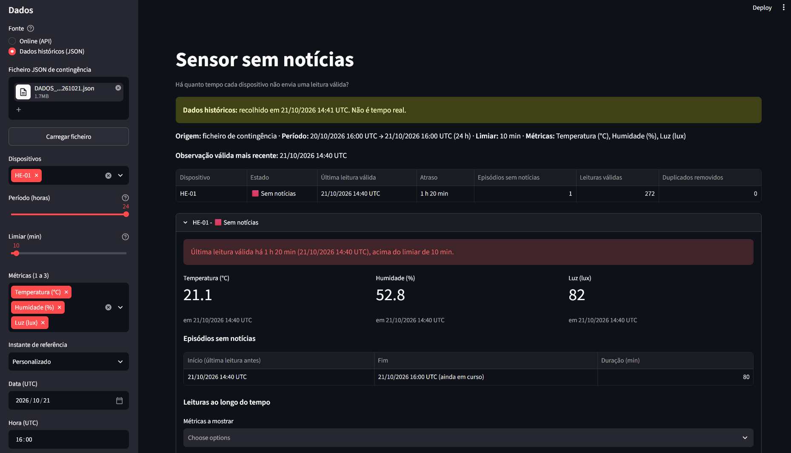
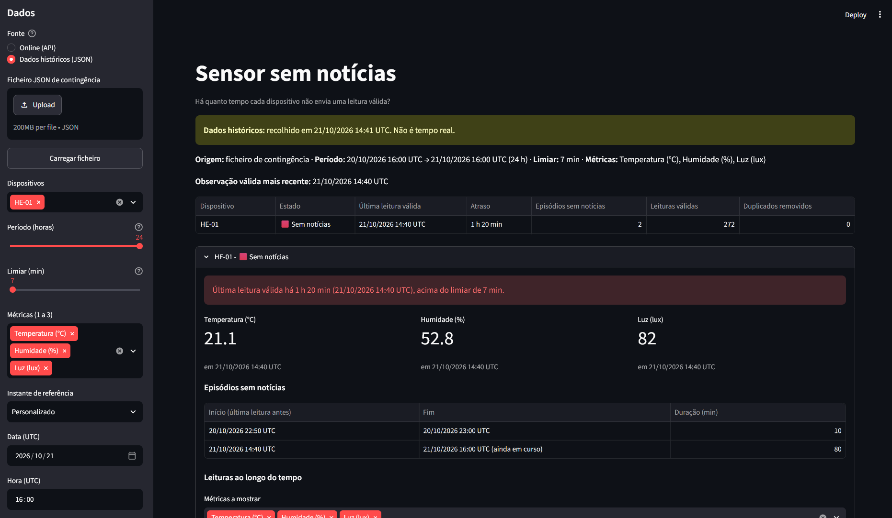
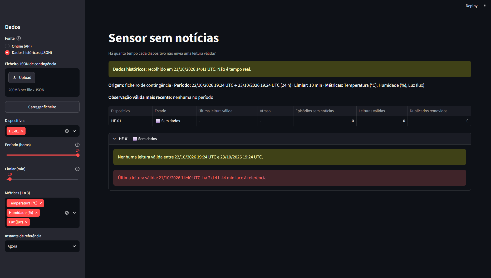
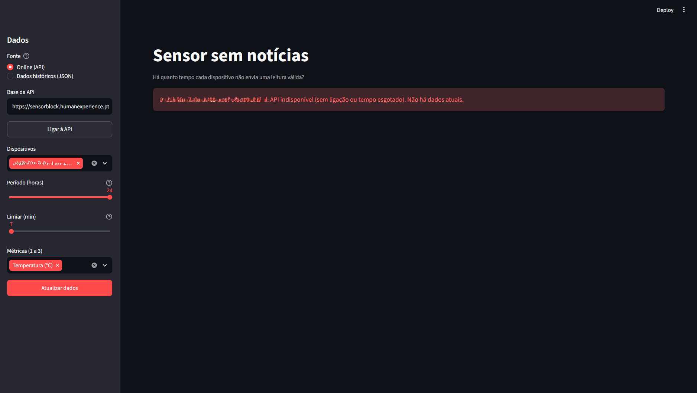

# Validação: três cenários

Resultados obtidos ao executar `python scripts/cenarios.py`. Cenários 1 e 2: recorte histórico real. Cenário 3: dados **simulados**.

| Cenário | Entrada | Resultado esperado | Resultado obtido | Evidência |
|---|---|---|---|---|
| 1. Normal (dados históricos reais) | HE-01; referência 21/10 14:42 UTC; período 24 h; limiar 10 min | Em dia; atraso de 2 min; última leitura válida 14:40 | estado=EM_DIA; última válida=21/10 14:40 UTC; atraso=2 min; episódios=0 ✔ |  |
| 2. Ativa a funcionalidade (dados históricos reais) | HE-01; referência 21/10 16:00 UTC (80 min após a última leitura); limiar 10 min. Depois: referência 14:42 e limiar 7 min | Sem notícias, atraso 1 h 20 min, episódio em curso; com limiar 7 min aparece a lacuna histórica de 10 min (22:50) | estado=SEM_NOTICIAS; última válida=21/10 14:40 UTC; atraso=1 h 20 min; episódios=1 \| limiar 7 min: episódios=1 ✔ | Estado e episódio em curso:  Limiar 7 min:  |
| 3. Dados em falta ou erro (SIMULADO) | (a) resposta vazia; (b) linha com todas as métricas null; (c) API indisponível (ligação recusada simulada) | (a) e (b) «Sem dados», sem atraso nem zeros; (c) mensagem de indisponibilidade, sem fingir tempo real | (a) SEM_DADOS, atraso=None; (b) SEM_DADOS, sem valor válido; (c) ApiError(network): API indisponível (sem ligação ou tempo esgotado). Não há dados atuais.  ✔ | Sem dados:  API indisponível:  |
